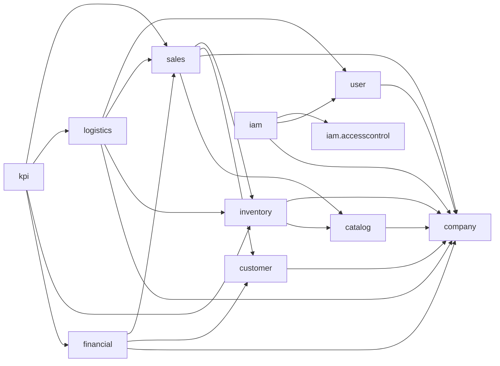
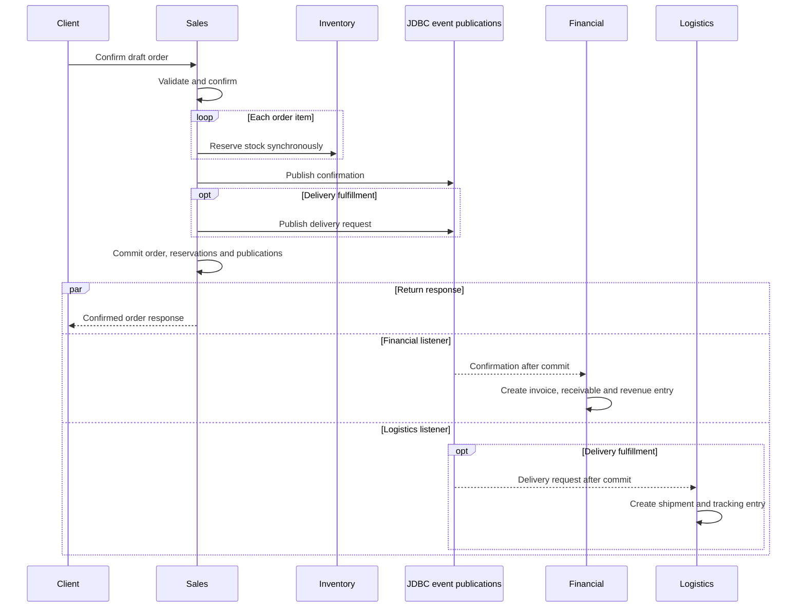

# Architecture

This ERP is a Java 21 / Spring Boot modular monolith: one application and one
PostgreSQL database, organized by business capability. Spring Modulith verifies
module boundaries and persists event publications through its JDBC integration.

[Domain](DOMAIN.md) · [Security](SECURITY.md) · [Testing](TESTING.md) ·
[Decisions](adr/README.md) · [Agent instructions](../AGENTS.md)

## Structure and ownership

Production code lives under `src/main/java/com/thiagsilvadev/erpapi`; tests mirror
that structure under `src/test/java/com/thiagsilvadev/erpapi`.

| Module | Owns |
| --- | --- |
| `catalog` | Categories, products, SKUs and base prices |
| `company` | Companies, addresses and company contacts |
| `customer` | Tenant-owned customers, suppliers and contact people |
| `user` | Global user identities and profiles |
| `iam` | Credentials, login and JWT issuance |
| `iam.accesscontrol` | Tenant memberships, roles, permissions, platform assignments and authorization audit |
| `inventory` | Warehouses, stock balances, reservations and movements |
| `sales` | Sales orders, buyers, items and fulfillment choices |
| `financial` | Invoices, payments, receivables/payables, financial accounts and accounting entries |
| `logistics` | Drivers, vehicles, shipments and tracking |
| `kpi` | Executive indicators aggregated through business-module APIs |
| `common` | Shared validation, value objects, tenant/security context, errors, numbering and reporting contracts |

Business modules expose facades, commands, snapshots, events and enums through
named `api` interfaces. Controllers, DTOs, models, repositories, use cases,
services and listeners stay in `internal`. `common` exposes specific named
interfaces rather than a general business-service layer. IAM access control is
a separately annotated nested module with its own public API.

## Dependencies

Arrows mean **the source module may depend on the target's public API**. These
are declared permissions in the modules' `package-info.java` files, not a list
of every runtime call. Shared `common` interfaces are omitted for readability;
the access-control node shows the dependency declared by IAM.

Use contracts from the owning module; cross-module entity/repository injection
is forbidden. The declarations can be inspected in, for example,
[sales](../src/main/java/com/thiagsilvadev/erpapi/sales/package-info.java),
[IAM](../src/main/java/com/thiagsilvadev/erpapi/iam/package-info.java) and
[KPI](../src/main/java/com/thiagsilvadev/erpapi/kpi/package-info.java).
[Architecture tests](TESTING.md) enforce boundaries and selected layering rules.

## Request, persistence and transaction flow

A controller validates a request DTO and calls a use case. The use case obtains
the active tenant, checks permissions, coordinates module contracts and invokes
domain behavior. Repositories persist local entities; mappers return DTOs or
snapshots. Entities and value objects hold business invariants.

JPA entities remain internal, with IDs used for references across modules.
The shared base entity provides identity, timestamps and optimistic versioning;
selected workflows also use pessimistic locks, such as invoice payment creation.
Use cases normally define command transactions and read-only query transactions.
Facades, domain services and event listeners also have transaction annotations
where their entry points require them; this is not a controller responsibility.

## Confirming a sale

The synchronous reservation participates in the confirmation workflow: a stock
failure prevents the sale transaction from completing. Financial and logistics
listeners use `@ApplicationModuleListener`, so their work occurs asynchronously
after commit in separate transactions. Their completion order is not guaranteed,
and an invoice or shipment may not exist when the confirmation response arrives.

Publications are persisted, but that is not a guarantee of exactly-once delivery
or automatic recovery under every failure. Creation listeners check for existing
order references. Cancellation listeners can reject processing after the sales
transaction has committed, for example when payments exist or a shipment has
already been loaded; the original sale transaction is not rolled back by that
later listener failure. See [ADR 0004](adr/0004-module-integration.md).

Sources: [confirmation use case](../src/main/java/com/thiagsilvadev/erpapi/sales/internal/usecase/ConfirmSalesOrderUseCase.java),
[financial listener](../src/main/java/com/thiagsilvadev/erpapi/financial/internal/listener/SalesOrderFinancialListener.java),
[logistics listener](../src/main/java/com/thiagsilvadev/erpapi/logistics/internal/listener/SalesOrderLogisticsListener.java).

## Deployment and schema lifecycle

Development uses Hibernate `ddl-auto=update`, local PostgreSQL and sample-data
seeders. Database tests use their own `erp_test` schema. No migration tool is
configured; production needs an explicit schema-management process before
persistent deployments. Flyway is the repository's intended migration tool
when adopted, as recorded in [ADR 0005](adr/0005-development-schema.md).

Observability exports are enabled through the `otel` profile and the optional
local LGTM stack. Setup commands and environment configuration belong in the
[README](../README.md); coding conventions belong in [AGENTS.md](../AGENTS.md).
