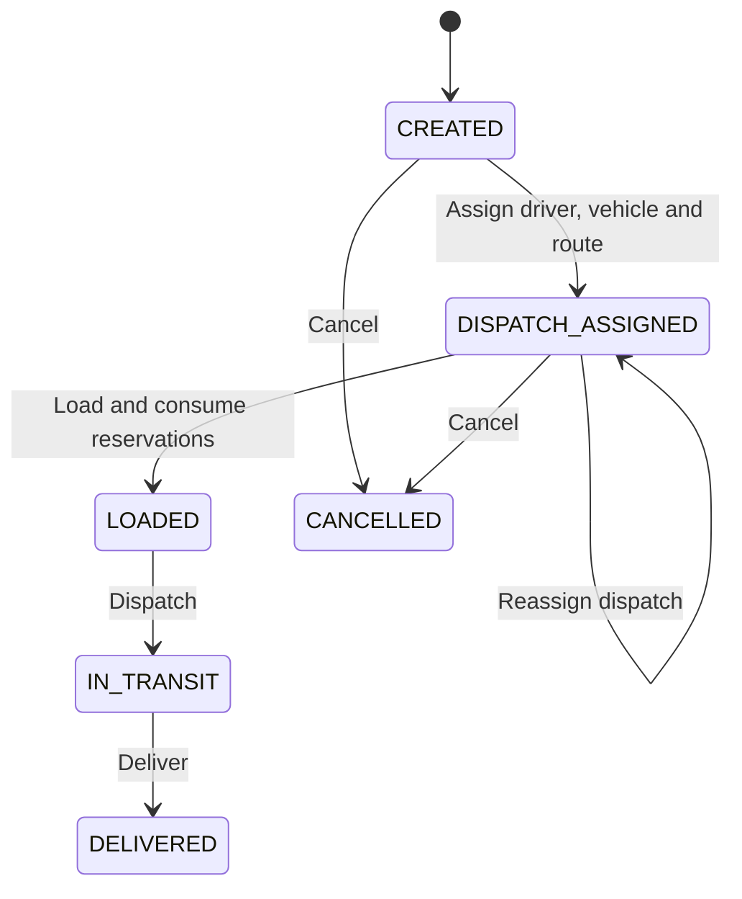

# ERP domain

This document describes the current business model and implemented rules.
[Architecture](ARCHITECTURE.md) · [Security](SECURITY.md) ·
[Testing](TESTING.md) · [Decisions](adr/README.md)

## Parties, ownership and catalog

| Concept | Meaning |
| --- | --- |
| Company / tenant | A business organization; selecting a company establishes the tenant for business requests |
| Factory / correspondent | Company types used to determine eligible buyers and sellers |
| User | A global identity and profile; tenant membership is a separate access-control concept |
| Customer | A buyer owned by a company, identified by a document within that company |
| Supplier | A tenant-owned supplier record, distinct from customer and company |
| Product / category | Tenant-owned catalog records; a product belongs to a category and has a SKU and a monetary base price |
| Warehouse | A tenant-owned storage location containing stock for products |

A company has a unique CNPJ and business number, legal name, type, address and
contact details. Customer documents are unique within the owning company.
Product SKUs and category codes are unique within a company. Products and
categories have active/inactive states.

Sources: [Company](../src/main/java/com/thiagsilvadev/erpapi/company/internal/model/Company.java),
[Customer](../src/main/java/com/thiagsilvadev/erpapi/customer/internal/model/Customer.java),
[Product](../src/main/java/com/thiagsilvadev/erpapi/catalog/internal/model/Product.java),
[Category](../src/main/java/com/thiagsilvadev/erpapi/catalog/internal/model/Category.java).

## Sales

- **B2B:** the seller must be a factory and the buyer a different correspondent
  company. **B2C:** a factory or correspondent sells to a customer belonging to
  the seller. The buyer representation accepts the party appropriate to the
  sale type.
- An order starts as `DRAFT` and requires items. Item quantities are positive;
  product names, SKUs and prices are captured from catalog snapshots. All items
  use the same currency.
- **PICKUP** orders have no delivery route. **DELIVERY** orders require one,
  and every item must use the route's single origin warehouse.
- Only a draft order can be confirmed. Confirmation reserves stock and publishes
  events for financial processing and, for delivery, shipment creation.
- Cancelling an order releases its reservations. A cancellation event is emitted
  when the order was confirmed; downstream restrictions are described below.

Sources: [creation workflow](../src/main/java/com/thiagsilvadev/erpapi/sales/internal/usecase/CreateSalesOrderUseCase.java),
[SalesOrder](../src/main/java/com/thiagsilvadev/erpapi/sales/internal/model/SalesOrder.java),
[SalesOrderItem](../src/main/java/com/thiagsilvadev/erpapi/sales/internal/model/SalesOrderItem.java),
[cancellation workflow](../src/main/java/com/thiagsilvadev/erpapi/sales/internal/usecase/CancelSalesOrderUseCase.java).

## Stock

`available = quantityOnHand - reservedQuantity`. Reserving stock reduces
availability without reducing stock on hand. Reservation and ordinary decrease
operations require sufficient available stock and positive quantities. Releasing
or consuming a reservation requires sufficient reserved stock. Consumption
reduces both reserved stock and stock on hand.

Reservations identify the sales order, product and warehouse. Loading a delivery
shipment consumes its order reservations; cancelling a sale releases them.
Movements record changes such as entries, exits, reservations and releases.

Sources: [InventoryItem](../src/main/java/com/thiagsilvadev/erpapi/inventory/internal/model/InventoryItem.java),
[InventoryFacade](../src/main/java/com/thiagsilvadev/erpapi/inventory/api/InventoryFacade.java),
[shipment loading](../src/main/java/com/thiagsilvadev/erpapi/logistics/internal/usecase/shipment/LoadShipmentUseCase.java).

## Billing, payments and accounting

An **invoice** records an amount, currency, due date and billing party; a
**ledger entry** records a receivable or payable. A **financial account** is a
cash/bank/payment destination, whereas an **accounting account** belongs to the
chart of accounts. Financial entries record account movements; accounting
entries record dated debit/credit postings.

Confirmation processing creates one invoice per sales-order reference, bills
the buyer company for B2B or customer for B2C, and creates a receivable. Its due
date is 15 days after confirmation. Explicit invoice creation linked to an order
requires a confirmed order and matching billing party, amount and currency, and
rejects an existing invoice for that order.

Payment creation locks the tenant's invoice, rejects paid/cancelled invoices,
and prevents recorded amounts from exceeding the invoice amount. A `PAID`
payment requires a destination account in the same tenant and creates an income
entry using the invoice currency. When recorded amounts equal the invoice
amount, the workflow marks it paid and settles its receivable. **The current
balance calculation sums payment records regardless of their status**; it must
not be described as a paid-only settlement calculation.

Cancelled invoices cannot be marked paid; paid invoices cannot be cancelled.
The financial cancellation listener rejects an order with existing invoice
payments; otherwise it cancels the invoice/receivable and reverses revenue.
This listener restriction is asynchronous, not an atomic precondition of the
sales cancellation response.

Accounting entries require a positive amount and support reversal of posted
entries by an opposite-direction entry. Invoice revenue currently creates a
single credit in the sales-revenue account and avoids repeating an existing
posting. It does not create a complete balanced journal transaction or enforce
that debits equal credits across all postings.

Sources: [invoice creation](../src/main/java/com/thiagsilvadev/erpapi/financial/internal/usecase/invoice/CreateInvoiceUseCase.java),
[payment creation](../src/main/java/com/thiagsilvadev/erpapi/financial/internal/usecase/payment/CreatePaymentUseCase.java),
[payment sums](../src/main/java/com/thiagsilvadev/erpapi/financial/internal/repository/PaymentRepository.java),
[Invoice](../src/main/java/com/thiagsilvadev/erpapi/financial/internal/model/Invoice.java),
[revenue posting](../src/main/java/com/thiagsilvadev/erpapi/financial/internal/service/AccountingPostingService.java),
[AccountingEntry](../src/main/java/com/thiagsilvadev/erpapi/financial/internal/model/AccountingEntry.java).

## Delivery and indicators

Delivery events create shipments containing snapshots of order items, a route
and tracking history. The logistics model enforces these transitions:

A route alone leaves the shipment in `CREATED`; dispatch assignment requires a
driver, vehicle and route details before loading. A shipment cannot be cancelled
after loading. The sales cancellation listener
checks that condition after the sales transaction commits. Driver workflows
restrict actions to the authenticated driver's assigned shipment.

Executive KPIs combine module snapshots for the active tenant. Money is grouped
by currency; reporting periods use UTC calendar dates. These aggregates are
queries, not an additional owner of sales, stock or financial records.

Sources: [Shipment](../src/main/java/com/thiagsilvadev/erpapi/logistics/internal/model/Shipment.java),
[driver workflow](../src/main/java/com/thiagsilvadev/erpapi/logistics/internal/usecase/driver/CurrentDriverShipmentWorkflowUseCase.java),
[KPI aggregation](../src/main/java/com/thiagsilvadev/erpapi/kpi/internal/usecase/GetExecutiveKpisUseCase.java).
